# Aksaraya - Digital Library Management

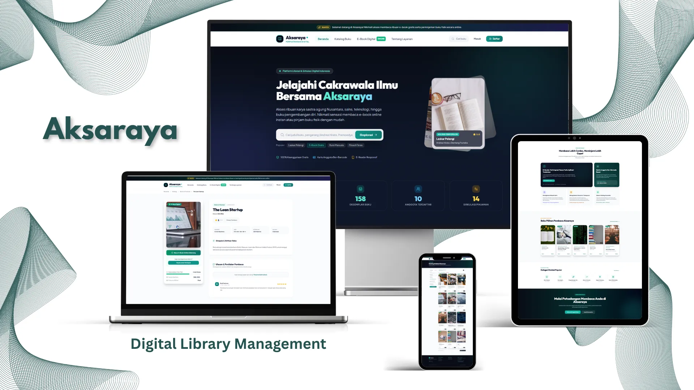


## Project Overview

Aksaraya is a full-stack digital library management system built on Laravel that unifies physical book circulation and browser-based e-book reading in a single web platform. It addresses the operational gap between manual inventory spreadsheets and modern reader self-service by providing multi-facet catalog discovery, automated stock synchronization, overdue fine computation, and role-segmented dashboards. Both registered library members and circulation staff interact through dedicated portals backed by transactional database integrity and configurable institutional rules.

## Key Features

- **Multi-Facet Public Catalog & Search**: Supports keyword search across title, author, ISBN, and publisher alongside category filtering, format filtering (e-book vs. physical), physical availability toggles, grid/list switching, and sorting by newest, popularity, title, or publication year.
- **Integrated Browser PDF E-Reader**: Delivers an in-browser reading workspace with Normal, Sepia, and Dark display modes, dynamic member-identity anti-piracy watermarks, fullscreen mode, PDF download, and asynchronous reading progress persistence (`last_page`, `total_pages`, `is_completed`).
- **Transactional Physical Circulation Workflow**: Manages online member loan requests (`pending`) through staff approval (`approved`), physical handover (`borrowed`), overdue tracking (`overdue`), and return verification (`returned`) wrapped in `DB::transaction` stock locks.
- **Walk-In Desk Borrowing & Barcode Lookup**: Provides a circulation desk form with an asynchronous barcode, ISBN, member number, and loan code lookup endpoint (`GET /admin/peminjaman/scan-barcode`) for instant form auto-population.
- **Automated Fine Calculation & Settlement**: Computes daily late penalties automatically upon return using configurable `loan_period_days` and `daily_fine_rate` settings, supporting both staff cash verification and simulated member QRIS fine settlement with payment references.
- **Member Engagement & Digital Library Pass**: Equips members with a printable holographic barcode membership card, personal custom bookshelves (`want_to_read`, `currently_reading`, `already_read`), annual reading challenges, bookmarks, and book ratings/reviews.
- **Circulation Notifications & Audit Logging**: Records simulated WhatsApp and email notifications (`loan_approved`, `due_reminder`, `overdue_alert`) via `CirculationNotificationService` whenever loans are approved or reminders are dispatched.
- **CSV Batch Inventory & Printable Reporting**: Enables administrators to export the entire catalog to UTF-8 BOM CSV, batch-import titles via CSV, and generate date-filtered circulation and financial reports with a printable official sheet.

## Tech Stack

| Category | Technology | Purpose |
|---|---|---|
| Backend Language | PHP 8.3 | Server-side application logic and strict type enforcement |
| Full-Stack Framework | Laravel 13 | MVC routing, session authentication, validation, and Blade rendering |
| Templating & UI | Blade + Tailwind CSS 4 | Server-rendered views and responsive utility-first styling |
| Client Interactivity | Alpine.js + Lucide Icons | Reactive barcode lookup, reader progress controls, and iconography |
| Database & ORM | SQLite + Eloquent ORM | Relational persistence across users, books, loans, shelves, and logs |
| Asset Bundling | Vite 8 + laravel-vite-plugin | Frontend CSS/JS bundling and font manifest compilation |
| Testing | PHPUnit 12 | Feature and unit verification using in-memory SQLite refresh migrations |
| Code Quality | Laravel Pint | Automated PSR/Laravel code formatting and style consistency |

## Application Architecture

Aksaraya uses a monolithic full-stack Laravel MVC architecture where Blade templates enhanced with Tailwind CSS and Alpine.js communicate with Laravel controllers over web routes and JSON fetch endpoints. Authentication and role-based access middleware (`CheckRole`) isolate public catalog browsing, member self-service portals, staff circulation operations, and administrator system configuration, while Eloquent ORM models coordinate transactional persistence with SQLite.

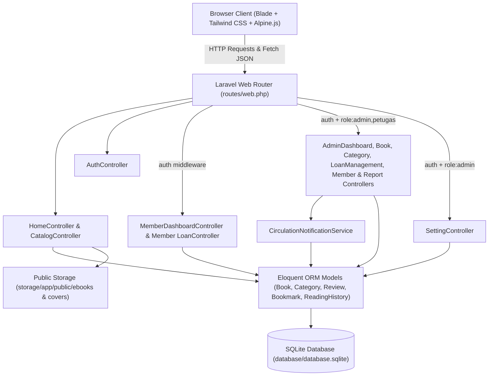

## Screenshots / Preview

### 1. Landing Page & Hero Section
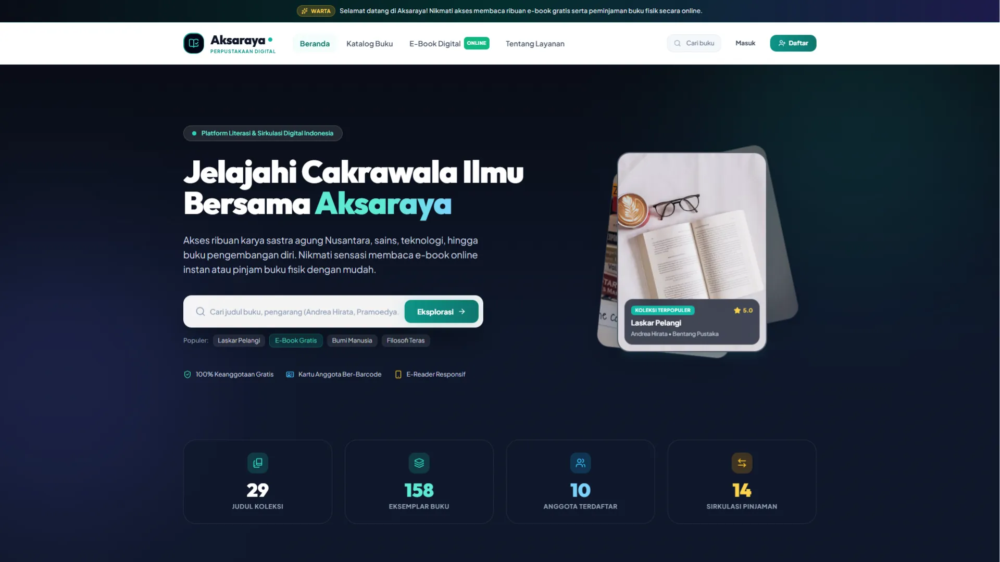
The primary public landing page introduces Aksaraya with a full-width dark hero header, an instant catalog search bar with quick-filter tags, a featured book spotlight, and four live metric cards summarizing collection titles, total physical copies, registered members, and circulation volume.

### 2. Platform Facilities & Value Highlights
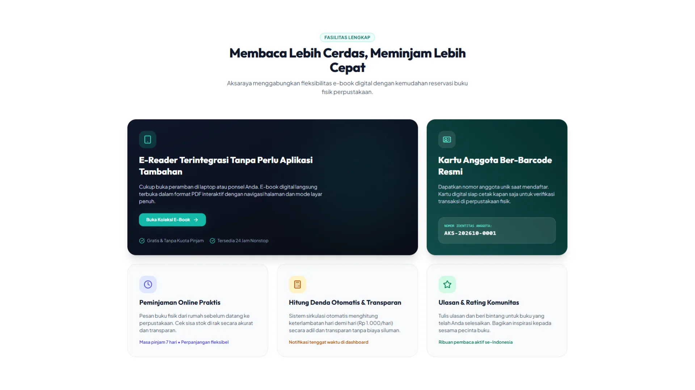
This homepage section highlights the core capabilities of the library platform through structured feature cards, including the zero-install browser E-Reader, official barcode member identification, online reservation flow, transparent daily fine calculation, and community book reviews.

### 3. Catalog Explorer & Multi-Facet Filter
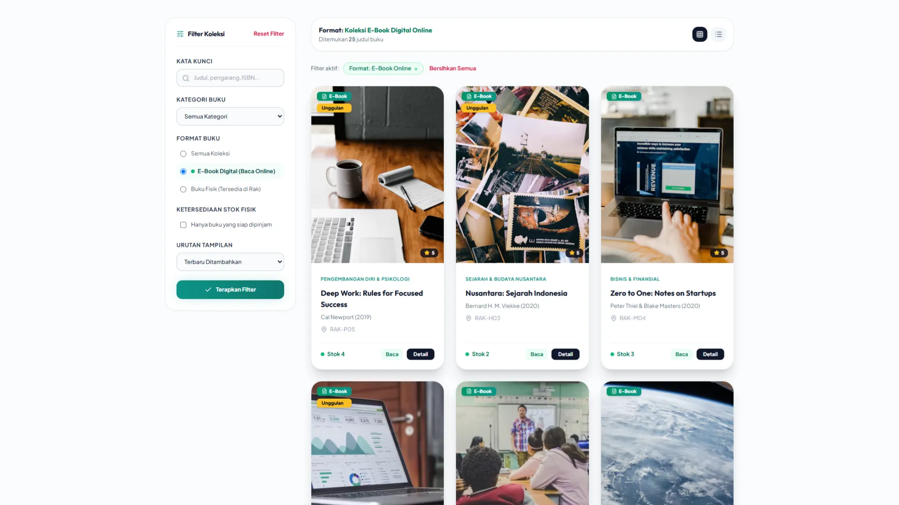
The catalog interface pairs a persistent left filter sidebar—covering keyword search, topic category, digital or physical format, physical stock availability, and sorting—with a grid/list toggleable collection view showing cover art, shelf codes, ratings, and available stock.

### 4. Borrowing Rules & Library Service Hours
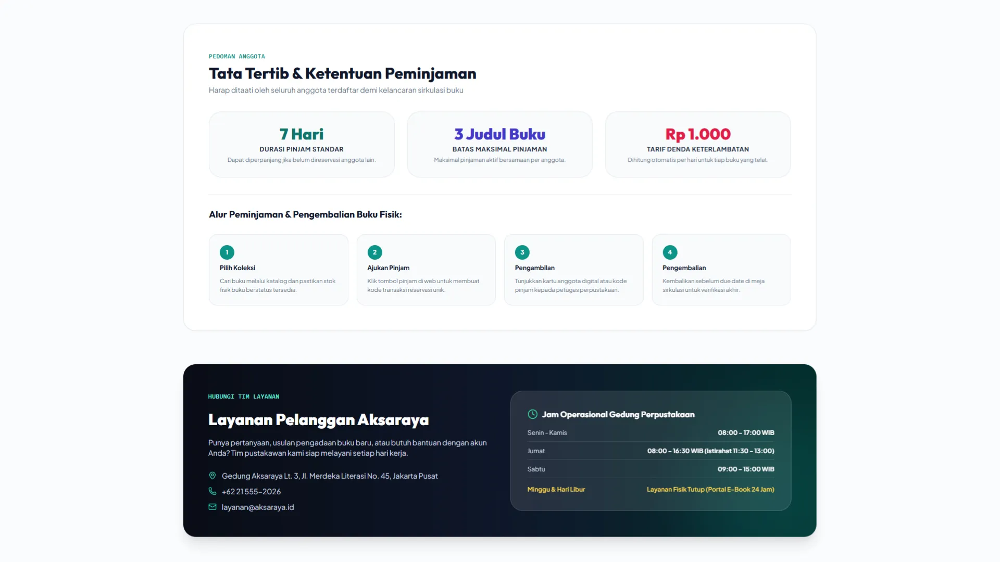
The service information view outlines institutional circulation policies—including a 7-day standard loan duration, a 3-book concurrent limit, and a `Rp 1.000` daily late fee—alongside a four-step physical borrowing guide, contact details, and library operating hours.

### 5. Member Dashboard & Reading Challenge
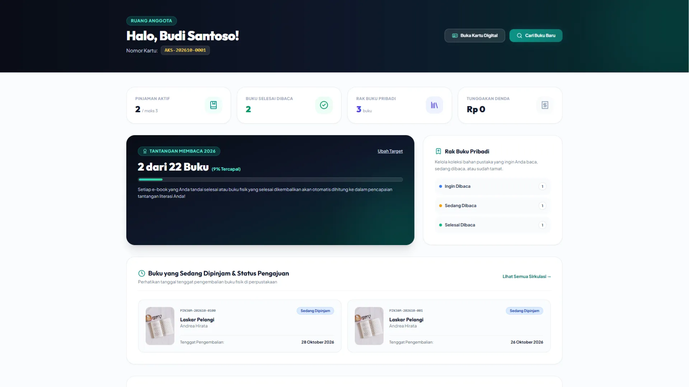
Authenticated members see a personalized overview displaying their member pass code, active loan count against the maximum quota, completed books, personal shelf totals, outstanding fines, an annual Reading Challenge progress tracker, and current loan due dates.

### 6. Digital Library Pass & Printable Barcode Card
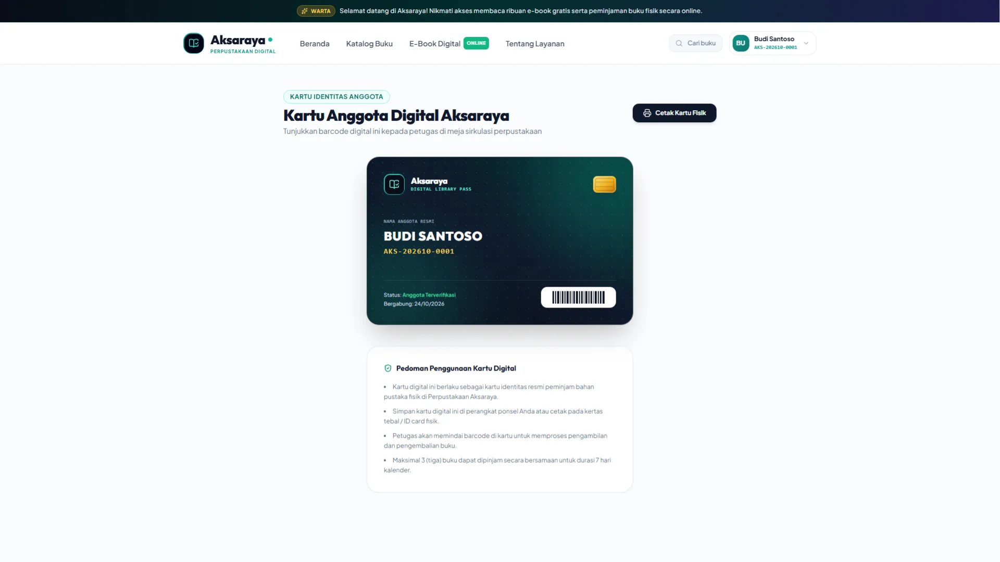
Each member receives a holographic digital library pass displaying their verified status, unique membership number, join date, and scannable barcode alongside a print-ready layout (`Cetak Kartu Fisik`) for physical circulation desk verification.

### 7. Book Detail, E-Book Access & Community Reviews
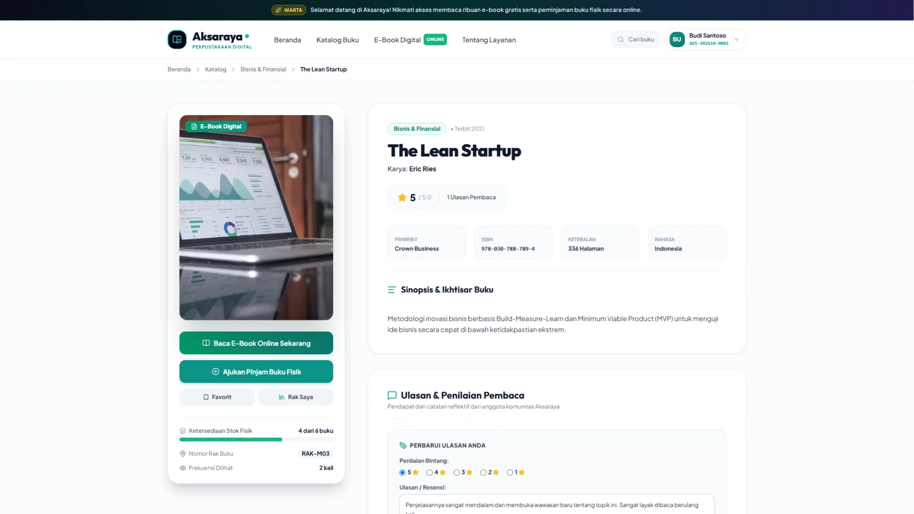
The book detail screen presents publication metadata (publisher, ISBN, page count, language), physical stock availability and rack location, instant CTAs to launch the online E-Reader or request a physical loan, shelf/bookmark toggles, and an interactive star-rating review form.

### 8. Member Circulation History & Loan Tracking
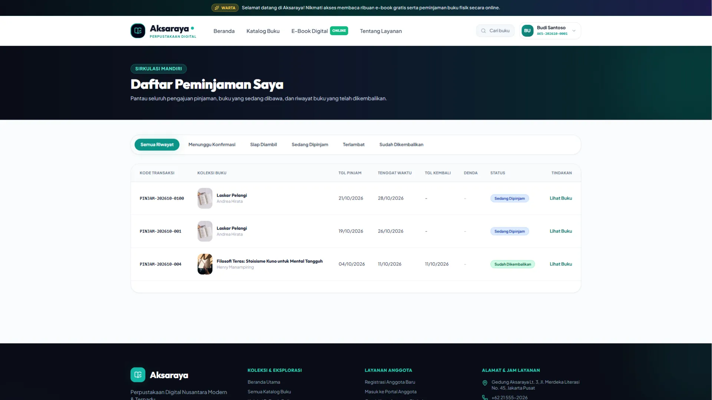
Members monitor all borrowing activity through status-filtered tabs (`Semua Riwayat`, `Menunggu Konfirmasi`, `Siap Diambil`, `Sedang Dipinjam`, `Terlambat`, `Sudah Dikembalikan`), with direct controls to cancel pending requests or settle accrued fines.

### 9. Admin Control Center & Circulation Overview
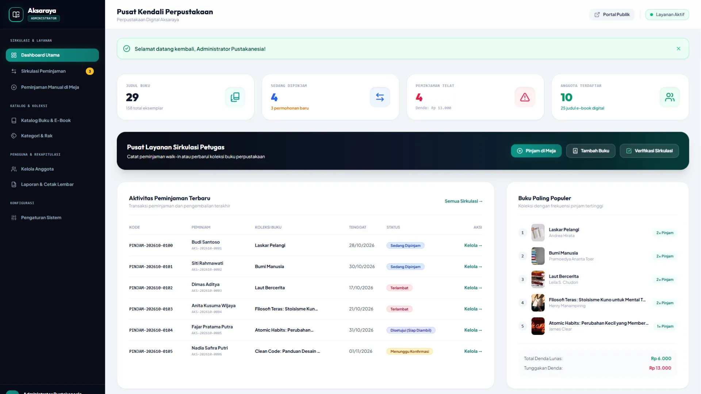
Library staff and administrators land on a sidebar-driven control center displaying inventory KPIs, active and overdue loan alerts, quick-action shortcuts for walk-in lending and cataloging, recent loan transactions, top borrowed books, and fine collection totals.

### 10. Circulation & Loan Management Console
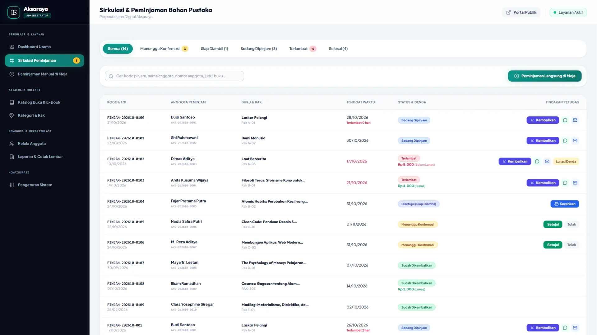
The circulation management table organizes loan records into real-time status tabs with search by loan code, member ID, or book title, enabling staff to approve or reject requests, hand over books, process returns with automatic fines, mark fines paid, and send WhatsApp or email reminders.

### 11. Walk-In Desk Borrowing & Barcode Scanner
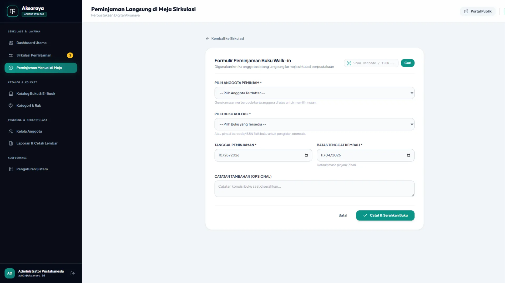
Designed for front-desk librarians, this walk-in transaction form includes a live barcode and ISBN scanner input that queries the backend lookup endpoint to auto-select registered members and available books while pre-filling the default 7-day due date.

### 12. Catalog & Collection Inventory Management
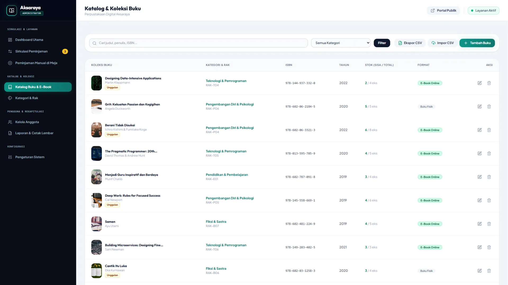
Administrators manage the library catalog from a searchable inventory table equipped with category filtering, one-click UTF-8 CSV export, batch CSV catalog import, and create/edit/delete workflows guarded against active loan deletions.

### 13. Category & Shelf Classification Manager
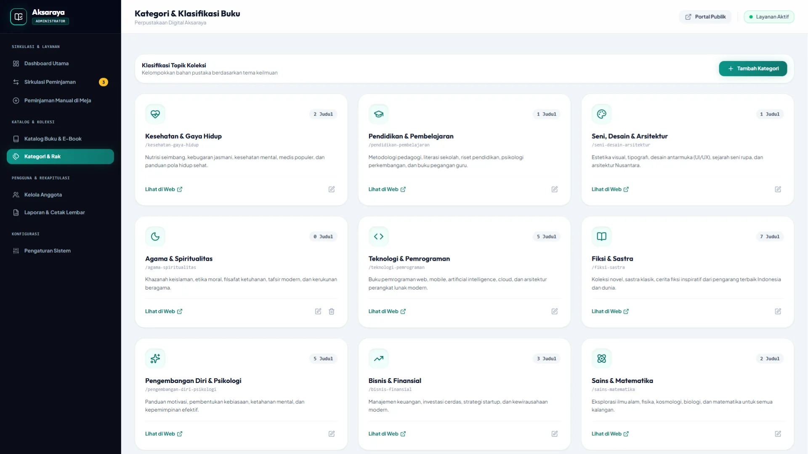
The taxonomy console displays all subject categories as structured cards with icon identifiers, URL slugs, descriptions, assigned title counts, public catalog links, and modal interfaces for adding, editing, or safely removing unused categories.

### 14. Member & Staff Account Directory
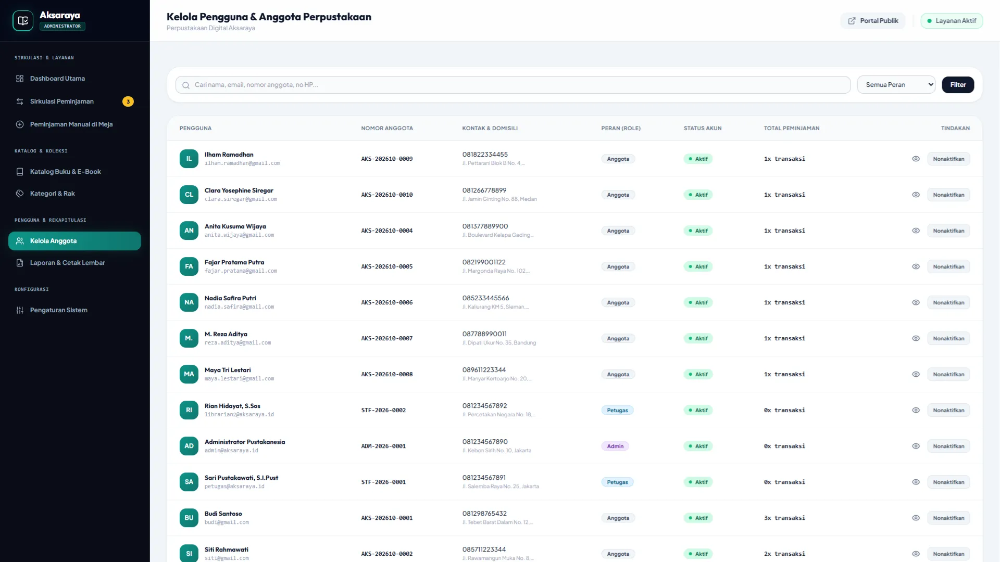
Staff can search and filter registered accounts across `Admin`, `Petugas`, and `Anggota` roles, inspect individual borrowing and review histories, and activate or deactivate member accounts with built-in safeguards protecting the sole administrator account.

### 15. Circulation & Financial Reports
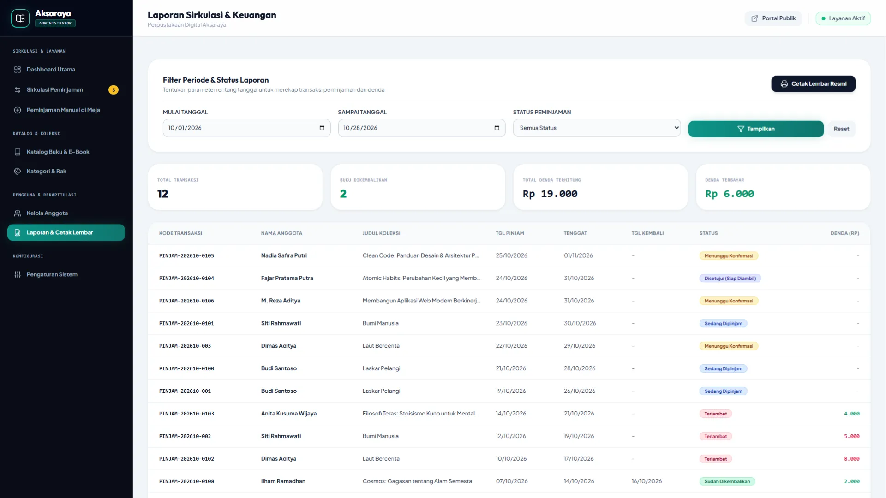
The reporting module aggregates circulation volume, return counts, total calculated fines, and settled fine revenue over customizable date ranges and statuses, with a dedicated `Cetak Lembar Resmi` view for printable audit sheets.

### 16. System Configuration & Library Policy Settings
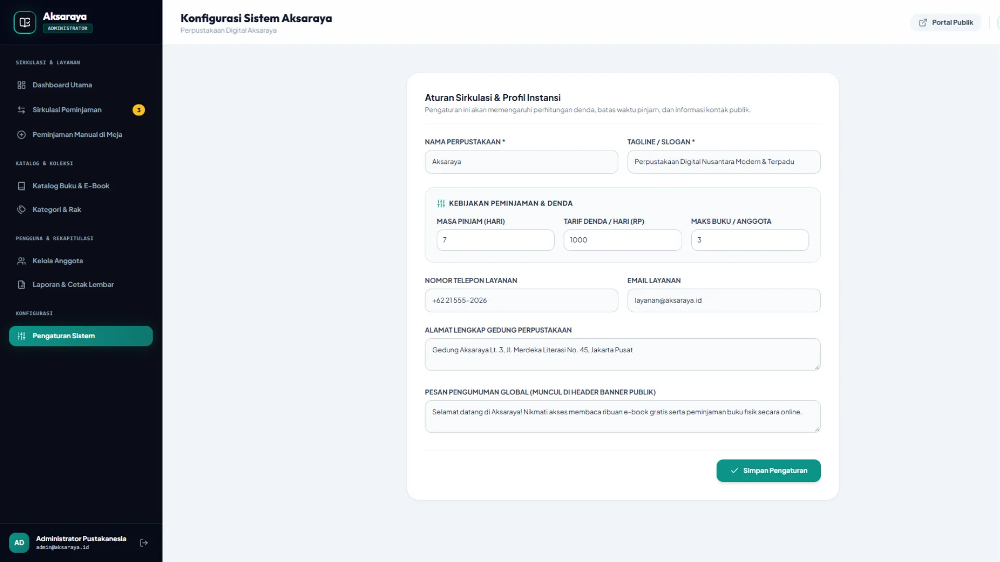
Restricted exclusively to the `admin` role, the system settings panel updates library branding, loan duration days, daily fine rates, maximum active borrows per member, physical contact details, and the global public announcement banner stored in the `settings` table.

## Prerequisites

- **PHP** `^8.3` with SQLite (`pdo_sqlite`), Mbstring, OpenSSL, Fileinfo, and Tokenizer extensions enabled
- **Composer** `2.x`
- **Node.js** `20.x` or later and **npm**

## Installation & Setup

1. Clone the repository and enter the project directory:
   ```bash
   git clone https://github.com/weztcy/Aksaraya-Digital-Library-Management.git
   cd "Aksaraya - Digital Library Management"
   ```
2. Install PHP and JavaScript dependencies:
   ```bash
   composer install
   npm install
   ```
3. Copy the environment configuration and generate the application key:
   ```bash
   cp .env.example .env
   php artisan key:generate
   ```
4. Ensure the SQLite database file exists, create the storage symlink, run migrations, and seed sample library data:
   ```bash
   touch database/database.sqlite
   php artisan storage:link
   php artisan migrate --seed
   ```
   *(Optional)* Run `php artisan db:seed --class=ComprehensiveLibrarySeeder` to populate extended categories, members, books, reading challenges, and notification logs.
5. Build frontend assets with Vite:
   ```bash
   npm run build
   ```

## Usage

Start the local Laravel development server (or run both PHP server and Vite watcher together) and sign in using the seeded accounts or register a new member account.

1. Start the application server and Vite dev server:
   ```bash
   php artisan serve
   npm run dev
   ```
2. Open `http://localhost:8000` in your browser to explore the public catalog and e-reader.
3. Sign in at `/login` using the seeded demonstration accounts (all use password `password`):
   - **Administrator**: `admin@aksaraya.id`
   - **Librarian Staff (`petugas`)**: `petugas@aksaraya.id`
   - **Library Member (`anggota`)**: `budi@gmail.com`

## Environment Variables

Application runtime, database connectivity, session persistence, and Vite branding are configured through `.env` based on `.env.example`.

| Variable | Description | Example |
|---|---|---|
| `APP_NAME` | Application display name across views and mailers | `"Aksaraya"` |
| `APP_ENV` | Runtime environment identifier | `local` |
| `APP_KEY` | Encryption key generated by `php artisan key:generate` | `base64:generated-key` |
| `APP_DEBUG` | Enables or disables detailed debug output | `true` |
| `APP_URL` | Base URL used for routing and storage URL generation | `http://localhost:8000` |
| `DB_CONNECTION` | Database driver (`sqlite` by default) | `sqlite` |
| `SESSION_DRIVER` | Session storage backend (`database` in local env) | `database` |
| `FILESYSTEM_DISK` | Disk used for uploaded covers and PDF e-books | `local` |
| `VITE_APP_NAME` | Application name exposed to Vite frontend builds | `"Aksaraya"` |

```env
APP_NAME="Aksaraya"
APP_ENV=local
APP_KEY=
APP_DEBUG=true
APP_URL=http://localhost:8000
DB_CONNECTION=sqlite
SESSION_DRIVER=database
FILESYSTEM_DISK=local
VITE_APP_NAME="${APP_NAME}"
```

## API Documentation

Alongside server-rendered Blade routes, Aksaraya exposes authenticated JSON and streaming endpoints consumed by the Alpine.js e-reader, barcode scanner, shelf manager, and CSV exporter.

| Method | Endpoint | Description | Authentication |
|---|---|---|---|
| `POST` | `/katalog/{id}/favorit` | Toggle bookmark status for a book (returns JSON when requested) | Session (`auth`) |
| `POST` | `/katalog/{id}/progress` | Persist e-book `last_page`, `total_pages`, and `is_completed` | Session (`auth`) |
| `POST` | `/anggota/rak-buku/{bookId}` | Assign or remove a book from personal shelves (`want_to_read`, `currently_reading`, `already_read`, `remove`) | Session (`auth`) |
| `GET` | `/admin/peminjaman/scan-barcode` | Lookup book ISBN/title, member number/email, or `loan_code` via `?code=` | Session (`auth`, `role:admin,petugas`) |
| `GET` | `/admin/books/export/csv` | Stream UTF-8 BOM CSV export of the complete book catalog | Session (`auth`, `role:admin,petugas`) |

```json
// GET /admin/peminjaman/scan-barcode?code=978-979-3062-79-2
{
  "found": true,
  "type": "book",
  "data": {
    "id": 1,
    "title": "Laskar Pelangi",
    "author": "Andrea Hirata",
    "isbn": "978-979-3062-79-2",
    "stock_available": 4,
    "shelf_location": "Rak A-01"
  }
}
```

## Database Configuration

Aksaraya uses SQLite (`database/database.sqlite`) by default via Eloquent ORM and defines 11 core application and framework tables across `database/migrations/`, including `users`, `categories`, `books`, `loans`, `reviews`, `bookmarks`, `reading_histories`, `reading_challenges`, `user_shelves`, `circulation_notifications`, and `settings`.

1. Verify `DB_CONNECTION=sqlite` in `.env` (or configure MySQL/PostgreSQL credentials if migrating to an external RDBMS).
2. Execute all schema migrations:
   ```bash
   php artisan migrate
   ```
3. Populate initial settings, users, categories, books, reviews, bookmarks, and sample circulation records:
   ```bash
   php artisan db:seed
   php artisan db:seed --class=ComprehensiveLibrarySeeder
   ```

## Authentication & Authorization

Authentication relies on Laravel's stateful session guard backed by `bcrypt` password hashing and database-stored sessions (`SESSION_DRIVER=database`), paired with custom `CheckRole` route middleware (`app/Http/Middleware/CheckRole.php`).

- **Three-Tier Role Model**: Users are assigned `admin`, `petugas` (librarian staff), or `anggota` (registered member) in `users.role`.
- **Account Active Enforcement**: Both `AuthController::login` and `CheckRole` verify `is_active === true`, logging out and blocking suspended accounts automatically.
- **Route Boundary Isolation**: Member portal routes (`/anggota/*`) require `auth`; catalog, circulation, member directory, and reporting routes (`/admin/*`) require `role:admin,petugas`; system policy settings (`/admin/pengaturan`) are restricted strictly to `role:admin`.
- **Self-Registration Guard**: Public sign-up at `/daftar` assigns the `anggota` role, generates a sequential member number (`PKN-YYYYMM-XXXX`), and regenerates the session ID on login.

## Testing

Feature and unit tests are configured in `phpunit.xml` to execute against an isolated in-memory SQLite database (`:memory:`) with `RefreshDatabase` and seeded fixtures (`tests/Feature/AksarayaTest.php`).

- **Feature Suite (`tests/Feature/AksarayaTest.php`)**: Verifies public page rendering (`/`, `/katalog`, `/tentang`, `/login`), member registration, member book borrowing (`pending` loan creation), and RBAC enforcement for guest and member access to `/admin/dashboard`.
- **Execution Command**:
  ```bash
  php artisan test
  ```

## Build & Deployment

Frontend styles and scripts are bundled via Vite into `public/build/`, while Laravel optimization commands prepare configuration, routes, and views for production hosting.

1. Compile production frontend assets:
   ```bash
   npm run build
   ```
2. Install production PHP dependencies and link public storage:
   ```bash
   composer install --no-dev --optimize-autoloader
   php artisan storage:link
   ```
3. Run database migrations and cache Laravel framework artifacts:
   ```bash
   php artisan migrate --force
   php artisan config:cache
   php artisan route:cache
   php artisan view:cache
   ```

## Contributing

Contributions are welcome to improve catalog features, circulation workflows, or test coverage. Please follow this standard workflow:

1. Fork the repository.
2. Create a branch for the change (`git checkout -b feat/your-feature`).
3. Make and test the changes (`php artisan test`).
4. Commit and push the branch.
5. Open a pull request with a clear explanation.

## License

This project is licensed under the MIT License.
See the [LICENSE](LICENSE) file for details.

## Author & Contact

**Yohanes Dimas Pratama**

- GitHub: [github.com/weztcy](https://github.com/weztcy)
- Portfolio: [yohanesdimas.com](https://yohanesdimas.com)
- LinkedIn: [linkedin.com/in/yohanes-dimas](https://www.linkedin.com/in/yohanes-dimas)
